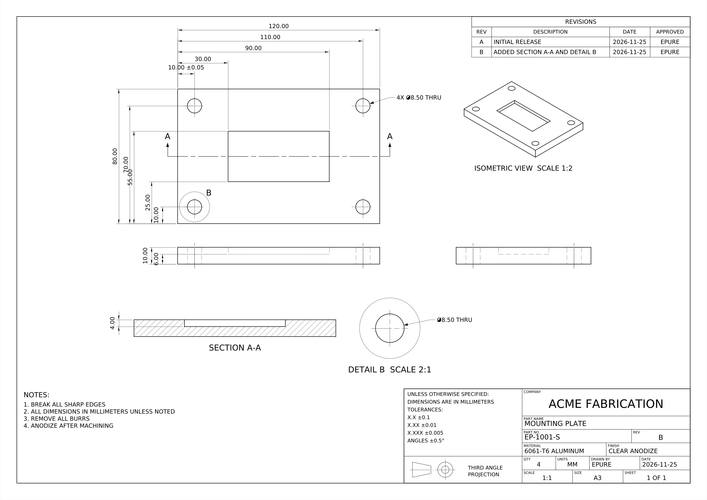
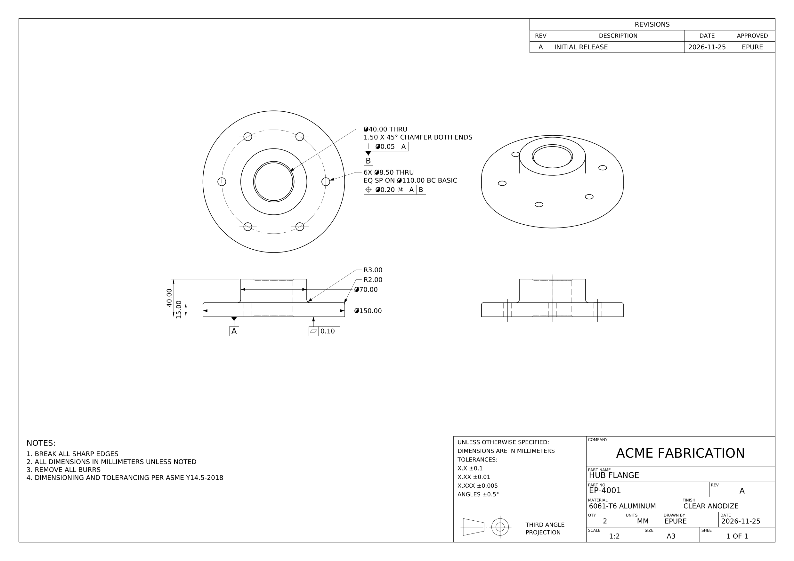
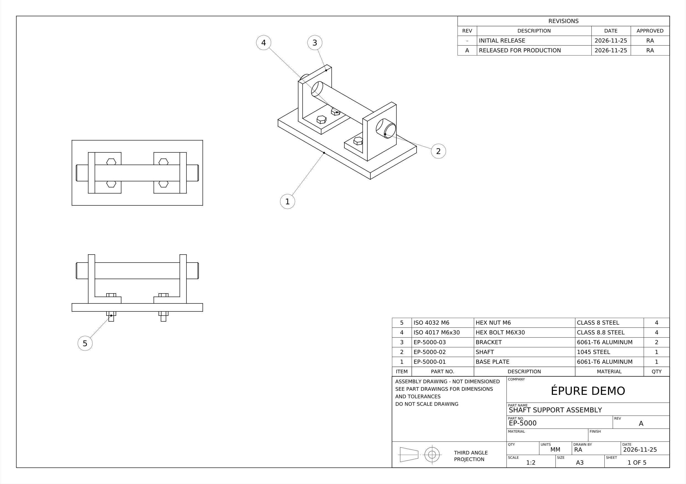
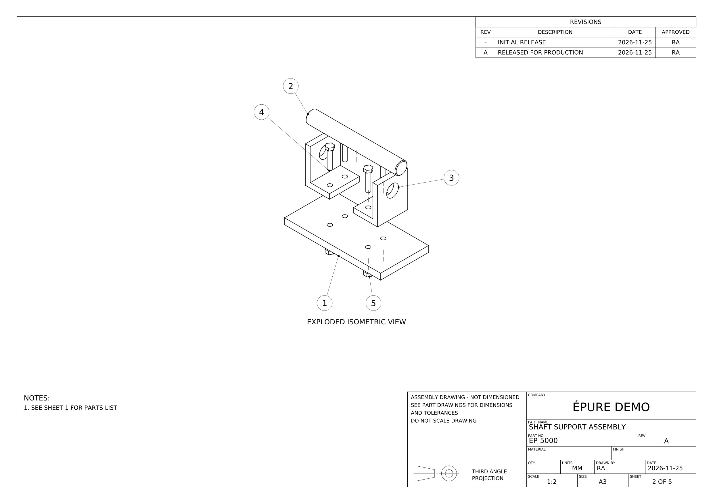
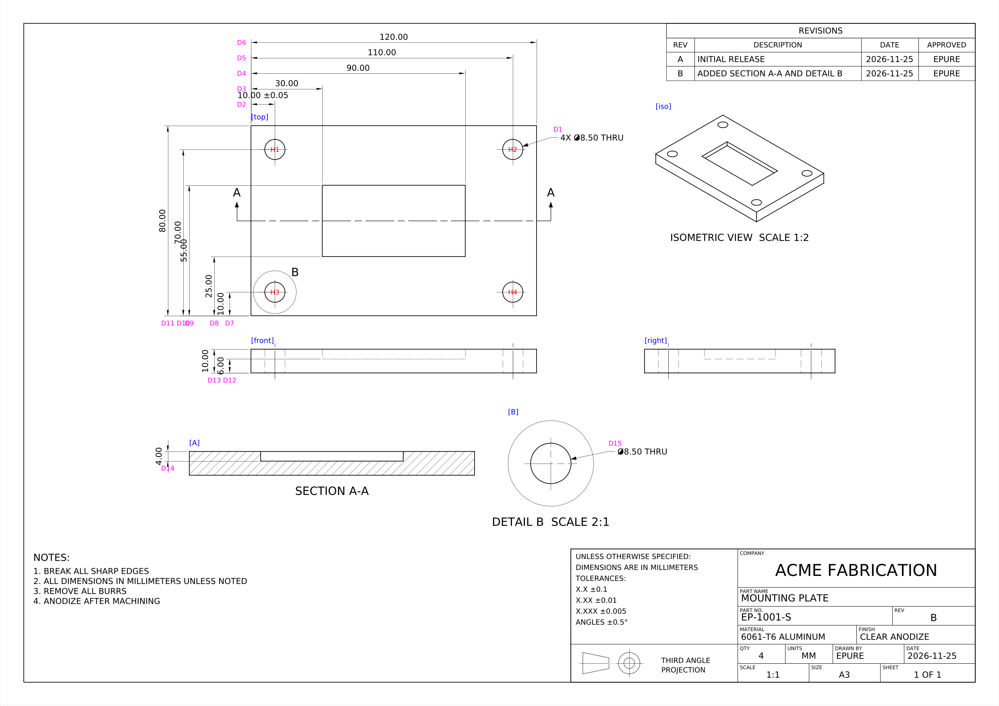

# Épure user guide

How Épure turns a 3D CAD file into a dimensioned shop drawing, what you can ask for in chat, and how to get a clean result.

## Contents

- [What Épure does](#what-épure-does)
- [Getting started](#getting-started)
- [A typical part job](#a-typical-part-job)
- [Dimensions, threads, and GD&T](#dimensions-threads-and-gdt)
  - [Threads](#threads)
  - [GD&T](#gdt)
- [Assemblies](#assemblies)
  - [Exploded views](#exploded-views)
- [The revision table](#the-revision-table)
- [Things you can say](#things-you-can-say)
- [Tips for clean drawings](#tips-for-clean-drawings)
- [Known limits](#known-limits)
- [File formats](#file-formats)

## What Épure does

Épure turns a 3D CAD file into a dimensioned 2D shop drawing. You send a model, it sends back a preview and an editable DXF, and you ask for changes in chat. When you say the drawing is good, you get a PDF.

**What you get**

- A dimensioned shop drawing from your 3D model
- An editable DXF plus a preview to review
- Quick changes in plain language, in chat
- A PDF once you approve the drawing

**What it does not do**

- It does not model or redesign parts
- It does not quote, order, or send work to a shop
- It does not run printers or give engineering sign-off
- It never invents a dimension that is not in the model
- It never adds a thread or GD&T without your yes

You give the finished drawing to the shop. Épure never emails or messages it to anyone on your behalf.

## Getting started

The first time you open a new Épure bot, it installs its drawing tools. That takes a few minutes and happens in the background. If something goes wrong, it will say so; it will not invent a drawing.

Then it offers to set up your title-block defaults, or you can skip and fill things in later. Every field is optional, and you can change any of them later in chat.

| Field | What it is | If you skip it |
| --- | --- | --- |
| Company or name | Printed in the title block | Left blank |
| Logo | An optional image file | No logo |
| Units | Inches or millimeters (this also picks ANSI or ISO sheets) | Ask in chat if it is unclear |
| Default tolerances | X.X ±0.1, X.XX ±0.01, X.XXX ±0.005, angles ±0.5° unless you give others | Those usual values |
| Projection | Third-angle or first-angle | Third-angle |
| Drawn by | Initials in the title block | Left blank |
| Standard notes | Break all sharp edges, all dimensions in the chosen units unless noted, remove all burrs | Those usual notes |

Once that is done, send your first CAD file. A STEP file is the best starting point.

## A typical part job

*A mounting plate after a few chat edits: section A-A, detail B, a tighter tolerance, a part note, and revision B. Sample title block for ACME FABRICATION.*

1. **Send the file.** STEP or STP is best. IGES and BREP also work. If you send a mesh (STL or OBJ), Épure will warn that sizes are approximate and holes are not recognized, and it will ask for a STEP export. Native CAD files such as SolidWorks, Fusion, or Inventor parts need a STEP export too.

2. **Fill in the part fields and notes.** Épure asks for part name, part number, revision, material, finish, and quantity. In the same message it asks if you have notes just for this part, for example heat treat, anodize after machining, or a masking area. Those notes join the standard notes on this drawing only. A skip means none. The date is filled in automatically, and the scale and sheet size are picked for you unless you say otherwise.

3. **Review the preview and the DXF.** You get a preview image and an editable DXF. This is a first draft. Épure will also mention anything it skipped or is unsure about.

4. **Ask for edits in chat.** Say what you want in ordinary language: move a dimension, add a note, cut a section, and so on. You get a new preview after each round. If a request is ambiguous, Épure asks one short question and points at the IDs on the marked-up preview.

5. **Approve it and get the PDF.** When you say the drawing looks good, Épure sends a PDF and the final DXF.

The DXF uses named layers (`VISIBLE`, `HIDDEN`, `CENTER`, `DIMENSIONS`, `GDT`, `TITLEBLOCK`, `NOTES`, `HATCH`), so you can turn them on and off in your CAD app. Measuring the geometry in AutoCAD, Fusion, LibreCAD, or similar should give real sizes in your chosen units.

## Dimensions, threads, and GD&T

On a typical part, Épure automatically adds overall and stepped dimensions, plus callouts for holes, counterbores, countersinks, counterdrills, slots, fillets (radius callouts), chamfers, bolt circles, and angles on slanted faces. You also get centre marks and centrelines, and the usual views: front, top, and right, plus an isometric view.

Compound-angle faces and variable fillets are never dimensioned automatically. If something was skipped, it will be mentioned with the draft.

### Threads

> [!NOTE]
> **Nothing is drawn until you say yes.** Threads and GD&T are only suggestions. Épure lists them in plain words and waits. A no, or a skip, leaves them off the drawing.

STEP files rarely keep thread data, so suggestions are guesses from tap-drill sizes, or from text found in the file. Épure will say something like: “H2: Ø6.8 blind hole looks like an M8x1.25 tap drill. Thread it?” You can answer “Yes, thread it M8x1.25” or “No, that is a clearance hole.”

Some sizes are ambiguous. For example, Ø8.5 is both the M10 tap drill and the M8 clearance hole. Épure will flag those and wait for you.

### GD&T

*A hub flange after accepted GD&T: datum A on the bottom face, datum B on the bore, flatness, perpendicularity, and a position frame on the bolt circle.*

After the first draft, Épure may also suggest datums and feature control frames, each with a plain-English reason. These come from the geometry only. They do not know how the part fits with others, which is why they stay off the drawing until you choose.

You can say “Keep datum A, B, and the flatness. Change the position tolerance to 0.2. Skip the rest.” or “Do not add any GD&T.” You can also ask for a datum or a frame that was not suggested, or have one removed.

## Assemblies

*An assembly sheet has no dimensions. Balloons and a parts list point to the component drawings for sizes and tolerances. Sample title block for Épure Demo.*

If the model has more than one part, Épure scans it first and does not start drawing until you choose. You get a numbered preview and a list of each item: its name, quantity, whether it looks like hardware, and a suggested part number.

Then it asks which parts should get their own dimensioned drawing. Hardware such as bolts, screws, nuts, washers, and pins defaults to no. For each part that does get a drawing, it asks for a part number (the default is the assembly number plus a suffix), material, finish, and any notes just for that part, plus the assembly name and number if those are still missing.

You then get the assembly preview, with balloons and a parts list but no dimensions, and a preview of each part drawing. Thread and GD&T suggestions are confirmed on each part, the same way as a single-part job. Dimension edits go on the part drawings, never on the assembly sheet. You can also ask to change a balloon, a parts-list field, or whether a part gets a drawing.

### Exploded views

*An optional exploded-view sheet. Parts are pulled apart and numbered to match the parts list on sheet 1. It has no dimensions of its own.*

In the same choose step, Épure asks if you also want an exploded-view sheet, with the parts pulled apart and numbered to match the parts list. You can turn that sheet on or off later. If parts overlap or a direction looks wrong, ask to move a part along X, Y, or Z, or to spread the explode farther.

When you approve an assembly job, you get a combined PDF of every sheet, plus one PDF per sheet. The usual order is the assembly, then the exploded view if you asked for one, then the part drawings.

### Long, thin parts

When a part or assembly is more than about 8 times longer than it is thick, such as a 2 m extrusion, Épure draws a broken view instead of shrinking everything to fit. A plain middle stretch is cut out and zigzag break lines mark the gap, so the scale can stay large enough to read the profile. The overall length is still dimensioned at its true value, underlined to show it is not to scale. A row of evenly spaced holes is dimensioned as a count and pitch, for example `13X 152.40 (=1981.20)`. The end view is always shown and dimensioned; if it is still small, Épure adds an enlarged detail of it. It may also pick a larger sheet when that clearly helps. You can ask to turn the break off, turn it on, or show more or less of the length.

## The revision table

Every drawing has a revision table, and it starts with an initial release row. When you change a drawing that has already gone out, or you ask for a new revision, Épure asks for a short description of the change (required) and a revision letter (the default is the next letter). That updates the table and the REV in the title block.

You can also ask to fix a row or remove one. An assembly and its parts each keep their own revision history, so revise each drawing that actually changed. The exploded sheet shares the assembly’s history.

## Things you can say

You do not need special commands. Say what you want in ordinary language. These are typical requests:

| You can say | What Épure does |
| --- | --- |
| Move dimension 4 up | Shifts that dimension so it is easier to read |
| Add a note: anodize black | Adds a note on this drawing only |
| Add a section through the middle | Adds a full section on an X, Y, or Z plane |
| Add a detail view on the lower-left hole | Adds an enlarged circular detail |
| Make this rev B, changed hole size | Adds a revision-table row and updates the title-block REV |
| Delete the 90 mm dimension | Removes that dimension |
| Put ±0.05 on the 10 mm height | Adds a tolerance to that dimension |
| Change the material to 304 stainless | Updates the title block |
| Hide hidden lines | Turns hidden lines off |
| Switch to first-angle projection | Changes how the views are laid out |
| Thread hole 2 M8x1.25 | Accepts that thread, using the callout you named |
| Keep datums A and B, skip the rest | Accepts only the GD&T you chose |
| Don’t make a drawing for the bolts | Leaves hardware off the part-drawing set |
| Move balloon 4 so it clears the shaft | Repositions that assembly balloon |
| Pull the shaft farther up on the explode | Adjusts the exploded-view distance or direction |
| Don’t break the rail / Break the long view | Turns the broken view off or on |
| Show 300 mm of the extrusion | Keeps more (or less) of a broken view’s length showing |
| Feedback / report a problem | Drafts a problem report, shows it, and sends it only after you say yes |

## Feedback

If something looks wrong, say `feedback` or `report a problem`. Épure will draft a short report, show it to you, and send it to the person who publishes the bot only after you say yes.

Leave out private chats, names, sheet links, files, and email addresses unless you mean to share them. You can add a handle or email if you want a reply.

Copies installed before this guide's 2026-11-26.2 update need one reinstall before the bot will offer this, because the built-in safety rules have to allow it.

## Tips for clean drawings

*The marked-up preview shows dimension IDs (D#), feature IDs, and view names. Use these when you want to point at a specific dimension.*

> [!WARNING]
> **Check it before it leaves your desk.** Treat the first drawing as a draft. Épure never invents a dimension that is not in the model, but a feature can still be missed or a dimension can land in a crowded spot. Check every dimension yourself before the drawing goes to a shop.

- Export STEP, not STL. Mesh files give approximate sizes and do not recognize holes.
- In an assembly, name the bodies or parts in your CAD app. Épure uses those names in the parts list.
- Set the units in the title block. If a BREP, STL, or OBJ file is in inches, say so; those formats are assumed to be millimeters.
- When you want to point at a specific dimension, use the IDs on the marked-up preview (`D4`, `H2`), or describe it, for example “the 55 on the left.”
- If you edit the DXF yourself in your CAD app, tell Épure and keep that file as the master. It will not overwrite your edits.
- On a dense part, ask for a detail view or a section, or ask to move crowded dimensions.
- If the views look oddly oriented, re-export the model with Z facing up, or accept the orientation and keep going.

## Known limits

These are the honest limits, so you know when to ask for a workaround or finish a detail yourself in the DXF.

- One sheet per part. Very large parts are scaled down, unless you ask for a larger sheet such as ANSI C or A2. Long, thin parts get a broken view instead.
- A broken view is cut only where there are no features (or through a row of evenly spaced holes), and only along one axis. A part with features all along its length is not broken. Exploded sheets are usually not broken.
- Names in Chinese, Japanese, or Korean print correctly when the CJK font from the installer is present. In the DXF they use a separate text style, so your CAD app needs a CJK font to show them.
- An assembly sheet has no dimensions and no section views. Nested sub-assemblies are flattened into parts.
- Exploded parts move only in straight X, Y, or Z lines, with no rotation. Parts are not checked for collisions after the move, so you may need to ask for a direction or distance change if something overlaps.
- Sections are full sections on the X, Y, or Z planes only. There are no offset, half, aligned, or broken-out sections.
- Curves in detail views become polylines, so arcs inside a detail may look faceted.
- Bolt circles need evenly spaced holes. Uneven patterns are dimensioned in X and Y instead.
- Side views do not show thread lines. An accepted thread gets a 3/4 circle in the end view.
- GD&T suggestions come from the geometry only, not from how the part mates. There are no composite frames, datum targets, or projected zones.
- Compound-angle faces, chamfers on those edges, non-axis-aligned holes, and variable-radius fillets are not auto-dimensioned.
- A part drawing uses that part’s own axes, so it may be oriented differently from how it sits in the assembly. Mesh files cannot be used as assemblies.
- A dense part may need dimensions moved so leaders do not cross.

## File formats

| Format | What to expect |
| --- | --- |
| STEP or STP | Best. Exact geometry, and units are read from the file. |
| IGES or IGS | Works if the file contains solids. Surface-only files get a warning, and through-hole detection may be wrong. |
| BREP | Works. The file has no units, so millimeters are assumed unless you say otherwise. |
| STL or OBJ | Works, but dimensions are approximate. Holes and slots are not recognized, and a note is added to the drawing. Prefer a STEP export. |
| Native CAD files | SolidWorks, Fusion, Inventor, CATIA, and similar part files, plus formats such as Parasolid, Rhino, or DWG, are not opened. Export a STEP file and send that. |

The drawing tools are published under the MIT license at https://github.com/realopenarmy/epure
